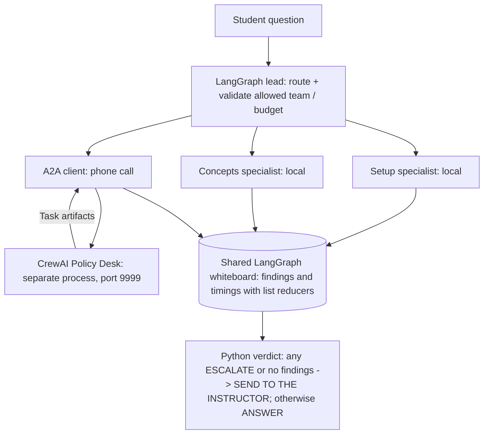

# Bootcamp Help Desk — Cross-Framework Agent Network

Module 7 Mini-Project | LangGraph + CrewAI + A2A

## Problem and design

Students ask questions about Python setup, agentic AI concepts, and bootcamp policies. A LangGraph lead routes each question to relevant specialists: local **setup** and **concepts** agents, and a remote **policy** CrewAI agent running in a separate Python process. The remote agent exposes an A2A agent card and receives `SendMessage` requests. The LangGraph manager reads the shared findings and computes the final verdict in Python rather than asking an LLM to decide.

## Architecture



The lead can select multiple specialists; the graph fans out and merges `findings` and `timings` using `Annotated[list[...], operator.add]`. Specialist names are checked against `MENU` and capped by `MAX_SPECIALISTS = 3`. The graph has `recursion_limit = 10`. The A2A card must advertise the required policy/deadlines tags; the client sends a JSON-RPC `SendMessage` and reads a completed Task's text artifacts. An unreachable desk, invalid reply, or incomplete task becomes an `ESCALATE:` finding (fail closed).

## How to run

Run from `Module-07-Multi-Agent-Systems/my-network` with Python 3.12 and the Module 2 virtual environment activated. The repo-root `.env` should contain `OPENROUTER_API_KEY` (never include it in the submission). Dependencies and the `shared/` package come from the parent Module 7 directory; use the course's `requirements.txt` if setup is missing.

Terminal 1 (leave running):

```powershell
python .\remote_desk.py
```

Terminal 2:

```powershell
python .\manager.py "ModuleNotFoundError: No module named 'crewai'"
python .\manager.py "I was sick, can I submit on Monday?"
python .\manager.py "I'm getting ModuleNotFoundError when importing crewai. Explain what CrewAI is and how to fix the installation error."
```

The A2A card is served at `http://127.0.0.1:9999/.well-known/agent-card.json`.

## Real test evidence

See the `evidence/` folder in the submitted project; these are saved terminal outputs, not simulated examples.

| Test | Routing | Observed decision / result | Measured cost |
|---|---|---|---|
| `run1.txt` — import error | `setup` (earlier saved run) | `ANSWER`; 289 tokens; 1 local LLM call; 2.4 s reported | $0.00011 local |
| `run2.txt` — late submission after illness | `policy` | `SEND TO THE INSTRUCTOR`; 2.0 s; 0 local LLM calls | $0.00000 local; remote metered separately |
| `fail_closed.txt` — same policy question with desk stopped | `policy` | Connection refused; `ESCALATE`; `SEND TO THE INSTRUCTOR` | $0.00000 local |
| `card.json` | N/A | Remote agent card captured from HTTP endpoint | N/A |
| `desk_log.txt` | `policy` | `SendMessage` received; Task completed; 227 tokens; 1 remote call | $0.00004 remote |

Additional interactive multi-specialist test (not necessarily in the evidence folder): the combined CrewAI explanation and import-error question routed to `setup, concepts`, produced `ANSWER`, took 3.9 s in parallel versus 7.8 s summed specialist times, and used 680 local tokens / 2 LLM calls at $0.00025.

**Note on costs:** the manager's meter does **not** include the remote CrewAI agent's token usage. The recorded desk log reports 227 tokens and $0.00004 for its own call. The local `$0.00000` on policy-only requests must not be presented as the total end-to-end cost. Also, the `run1.txt` snapshot was recorded before adding `crewai` to concept-routing keywords, so rerunning that exact question with the latest code may select `setup, concepts` instead of only `setup`.

## Would one agent have been enough?

For a small help desk with straightforward setup or concept questions, **one agent likely would have been enough** and cheaper to operate. In the recorded setup run, the local path required one LLM call, 289 tokens, $0.00011 and 2.4 seconds. The multi-specialist question required two local calls, 680 tokens and $0.00025, although parallel execution reduced the elapsed specialist time from 7.8 to 3.9 seconds. A single-agent baseline was **not** benchmarked, so these figures do not prove that multi-agent is more accurate or cheaper. The benefit of this design is separation of responsibilities: a distinct remote policy owner, a discoverable A2A interface, and code-enforced escalation when policy confirmation is needed or the remote desk is unavailable. The remote policy call has its own cost: one logged request used 227 tokens and $0.00004, outside the manager's meter.

## Submission

Attach a ZIP containing `my-network/README.md`, `manager.py`, `remote_desk.py`, and `evidence/run1.txt`, `run2.txt`, `fail_closed.txt`, `card.json`, and `desk_log.txt` to a GitHub issue using the **M7 Mini-Project — The Agent Network** template in the Students repository. Do not include `.env`, keys, `.venv`, caches, or backup files. The code expects the course's parent `shared/` folder when run.
